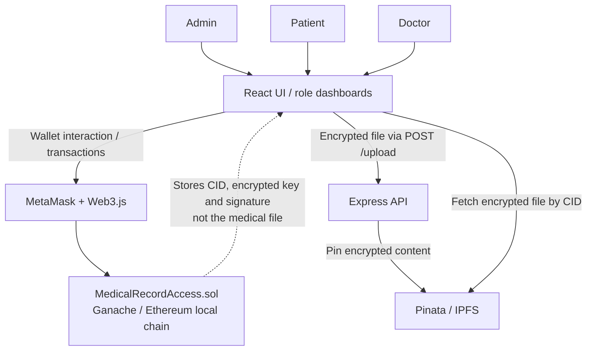

# Health Access DApp

**An academic proof of concept for role-based access to encrypted medical records using Ethereum smart contracts, IPFS and a React application.**

> **Project status:** Academic / historical proof of concept (CT492). This repository documents the existing implementation; it is **not production-ready**, security-audited or suitable for real patient data. The GitHub documentation and repository layout were cleaned up without redesigning the running application or redeploying contracts.

## Overview

A medical record can contain highly sensitive information. This project explores a hybrid approach in which a Solidity smart contract records user roles, access requests, approvals and record references, while an encrypted file is uploaded off-chain to IPFS through Pinata.

The three application roles are **Admin**, **Patient** and **Doctor**. The prototype uses MetaMask and a local Ganache-based blockchain. The encryption and decryption steps take place in the browser; the Express service forwards encrypted uploads to Pinata.

## Implemented functionality

| Role / area | Functionality present in this repository |
| --- | --- |
| Admin dashboard | Assign Patient or Doctor roles to existing wallet addresses; view registered addresses and roles. |
| Doctor dashboard | Generate a 2048-bit RSA key pair, publish the public key on-chain, request access to a patient's record, and download/decrypt a record using a supplied private key. |
| Patient dashboard | Review access requests; select a file, encrypt it locally and approve a request by uploading the encrypted file and registering its metadata on-chain. |
| Smart contract | Store roles, profile fields, public keys, access requests, CID references, encrypted key material and signatures; expose record deletion and access revocation functions. |
| Express upload API | Accept a file at `POST /upload` and forward it to the Pinata pinning API. |

**Scope distinction:** Smart contract functions such as `deleteRecord` and `revokeAccess` exist on-chain but are not exposed as complete workflows in the current dashboards. The current UI does **not** let a patient select an access-expiry time.

## Architecture



**On-chain:** roles, user details, access requests, record IDs, IPFS CIDs, an RSA-encrypted AES key/IV, signatures and Solidity events. **Off-chain:** the encrypted file stored via Pinata/IPFS. **In the browser:** AES/RSA operations, MetaMask signing, download and decryption. The smart contract does not itself communicate with IPFS.

For component boundaries, data flow and historical deployment details, see [Architecture](docs/architecture.md).

## Main workflow

1. An administrator assigns `Patient` or `Doctor` to a wallet address.
2. A doctor generates an RSA key pair; the public key is stored in the contract and the private key is shown to the doctor for safekeeping.
3. The doctor submits an access request with a stated purpose.
4. The patient selects a medical file. The browser encrypts the file using AES-256-CBC, encrypts the AES key plus IV for that doctor's RSA public key, and signs a hash of the encrypted key string via MetaMask.
5. The browser sends **the encrypted file** to the Express API, which uploads it to Pinata. The patient then submits an approval transaction containing the CID, encrypted key and signature.
6. The doctor retrieves the on-chain metadata and encrypted file, checks the signature and decrypts the content with the matching RSA private key.

Read the detailed [Application Workflows](docs/workflows.md) for function and code references.

## Security design and boundaries

| Mechanism | What the prototype actually implements |
| --- | --- |
| Role-based permissions | Solidity `roles` mapping and `onlyAdmin`, `onlyPatient`, `onlyDoctor` modifiers for specific contract functions. |
| File confidentiality | AES-256-CBC encryption in the patient browser before upload to Pinata. |
| Sharing a decryption key | RSA-OAEP encryption of the AES key and IV using the doctor's on-chain RSA public key. |
| Signature check | The patient signs a hash of the **encrypted AES key string**; the doctor UI recovers the signing address. This is **not** a signature over the entire file. |
| Metadata and audit-related events | CID, encrypted key and signature stored on-chain; events cover certain state changes, **not every download or read**. |
| Access management | The contract stores authorization state; it does not stop independent retrieval of public on-chain metadata or previously downloaded IPFS content. |

**Security limitations are part of this project**, not hidden: patient PII is stored in public state, the `records` mapping is public, CBC encryption lacks built-in authenticity, the API does not authenticate uploads, and approved access has no practical expiry (`type(uint).max`). See [Security Notes](docs/security-notes.md) for evidence and impact. Never use real patient records or real identity data in this prototype.

## Technology stack

| Layer | Technology |
| --- | --- |
| Web application | React, Web3.js, Axios, Tailwind CSS |
| Browser cryptography | `node-forge` (as imported in current source), MetaMask signing |
| Upload service | Node.js, Express, Multer, Axios, `form-data` |
| Smart contract | Solidity `^0.8.19`, Truffle migration scripts, Ganache (local) |
| File storage | Pinata/IPFS |

## Repository layout

```text
Health-Access-DApp/
├── README.md
├── .gitignore
├── docs/
│   ├── architecture.md
│   ├── workflows.md
│   └── security-notes.md
├── medical-access-app/
│   ├── backend/
│   │   ├── .env.example        # Names only; never commit working credentials
│   │   ├── package.json
│   │   └── server.js           # POST /upload -> Pinata
│   ├── public/
│   ├── src/
│   │   ├── components/         # Active reusable UI components
│   │   ├── contracts/          # Frontend contract helper and ABI artifact
│   │   ├── pages/              # Admin / Patient / Doctor dashboards
│   │   ├── App.js
│   │   └── index.js
│   ├── package.json
│   └── package-lock.json
└── medical-contract/
    ├── contracts/MedicalRecordAccess.sol
    ├── migrations/2_deploy_contracts.js
    ├── build/contracts/MedicalRecordAccess.json   # Retained historical artifact
    ├── package.json
    └── truffle-config.js
```

Unused alternative contract helpers and obsolete UI components have been removed; active dashboard, contract, upload and crypto code was **not** refactored.

## Historical local setup (reference only)

This is an archived local-development project, **not a verified clean-install tutorial**. Reproducing it may require resolving old dependencies, recovering the original Ganache accounts and network state, and aligning the frontend contract address with a newly deployed contract. Do not deploy it using actual sensitive information.

**Prerequisites:** Node.js/npm, MetaMask, Ganache at `127.0.0.1:7545`, Truffle CLI for the migration commands, and a Pinata account for test-only encrypted files.

```bash
# From the repository root: historical smart-contract commands
cd medical-contract
npm install
truffle compile
truffle migrate --network development
```

```bash
# In medical-access-app (project root), install its historical dependencies
cd medical-access-app
npm install

# Configure the upload API in a separate terminal
cd backend
# Create .env from .env.example and supply your own TEST Pinata JWT
npm start

# In another terminal, start the frontend from medical-access-app/
npm start
```

The frontend connects to MetaMask and uses an **address hard-coded in** [`src/contracts/MedicalRecordAccess.js`](medical-access-app/src/contracts/MedicalRecordAccess.js). It consumes the ABI at [`src/contracts/MedicalRecordAccess.json`](medical-access-app/src/contracts/MedicalRecordAccess.json), **not** the removed legacy `src/abi/` file. The historical Truffle build artifact and frontend ABI artifact specify *different network-5777 addresses*; do not blindly overwrite one or assume either address exists in a fresh Ganache chain. A fresh deployment would require updating the active frontend helper; this cleanup does not perform any deployment.

**Historical dependency caveat:** `node-forge` is imported by the UI but not declared as a direct dependency in `medical-access-app/package.json`. The backend `package.json` omits dependencies used by `server.js` (which may have been resolved from the parent application's installation in the original environment). These pre-existing manifest limitations have deliberately not been changed as part of this documentation-only cleanup; a clean installation is **not guaranteed**.

The backend needs only `PINATA_JWT` from the supplied environment file (`PORT` is optional). Never commit `.env`, publicize an API secret, or upload real patient records. If prior commits already exposed credentials, rotate them at the provider and clean the affected Git history through an appropriate review process.

## Reading guide

- [Architecture and component boundaries](docs/architecture.md)
- [Role-based workflows and file encryption/decryption](docs/workflows.md)
- [Security implementation, risks and limitations](docs/security-notes.md)

## Disclaimer

This project is for **learning, demonstration and portfolio review only**. It has not undergone an external audit or production hardening. Any sample identities and medical files used with it must be fictitious. Access control expressed in smart-contract code is not equivalent to confidentiality of public blockchain state or of IPFS content.
