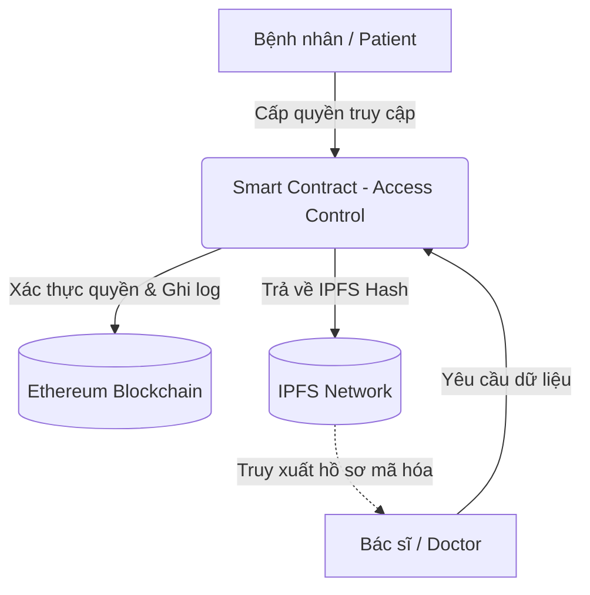

# CT492: Health Access DApp

Dự án này là một nền tảng quản lý hồ sơ bệnh án điện tử (EHR) được thiết kế nhằm nâng cao tính bảo mật, toàn vẹn và quyền riêng tư của dữ liệu bệnh nhân thông qua việc kết hợp công nghệ Blockchain và mạng lưu trữ phân tán IPFS.

## Kiến trúc hệ thống (Architecture)



## Tính năng chính (Key Features)

*   **Quản lý quyền truy cập (Access Control):** Bệnh nhân (Patient) có quyền thêm bác sĩ và chủ động thiết lập thời hạn truy cập hồ sơ bệnh án của mình.
*   **Bảo mật dữ liệu (Data Security):** Hồ sơ thực tế được lưu trữ ngoài chuỗi (Off-chain) trên mạng IPFS để giảm bớt chi phí giao dịch, trong khi mã băm (Hash) của dữ liệu được lưu trên Blockchain để đảm bảo tính toàn vẹn (Integrity) của hồ sơ.
*   **Phân quyền người dùng (Role-Based):** Hệ thống phân biệt rõ ba vai trò: Admin, Bác sĩ và Bệnh nhân thông qua các dashboard riêng biệt.
*   **Minh bạch & Truy xuất nguồn gốc:** Mọi yêu cầu truy cập và thay đổi quyền đều được Smart Contract ghi nhận.

## Cấu trúc thư mục (Folder Structure)

Cấu trúc dự án được chia thành 2 phần chính:

```text
CT492/
├── medical-access-app/     # Ứng dụng chính bao gồm Frontend và Backend
│   ├── backend/            # Dịch vụ API Backend (Node.js/Express)
│   │   ├── uploads/        # Thư mục lưu trữ tạm thời
│   │   ├── .env            # Cấu hình biến môi trường
│   │   └── server.js       # Entry point của Backend
│   └── src/                # Giao diện người dùng (ReactJS / Web3)
│       ├── abi/            # Chứa MedicalRecordAccess.json (ABI)
│       ├── components/     # Các UI components tái sử dụng
│       ├── config/         # Cấu hình kết nối contract
│       ├── pages/          # Các trang Dashboard cho Admin, Doctor, Patient
│       └── utils/          # Các hàm hỗ trợ xử lý blockchain & ipfs
└── medical-contract/       # Hệ thống Smart Contract
    ├── contracts/          # Chứa file MedicalRecordAccess.sol
    └── migrations/         # Các script triển khai (deploy) contract
```

## Ngôn ngữ và Công cụ (Tech Stack)

*   **Frontend:** ReactJS, Web3.js
*   **Backend:** Node.js, Express
*   **Blockchain / Smart Contract:** Solidity, Truffle, Ganache (Mạng local)
*   **Lưu trữ phân tán:** IPFS

## Hướng dẫn cài đặt (Getting Started)

**1. Biên dịch và Triển khai Smart Contract**
```bash
cd medical-contract
npm install
truffle compile
truffle migrate --network development
```
*Ghi chú: Sau khi deploy, hãy copy file `MedicalRecordAccess.json` từ `medical-contract/build/contracts/` sang thư mục `medical-access-app/src/abi/` để Frontend nhận diện được cấu trúc mới nhất.*

**2. Khởi chạy Backend API**
```bash
cd medical-access-app/backend
npm install
# Khởi chạy server API (cấu hình .env trước nếu cần thiết)
npm start 
# Hoặc: node server.js
```

**3. Khởi chạy Giao diện Frontend**
```bash
cd medical-access-app
npm install
npm start
```
*Giao diện ứng dụng sẽ khởi chạy tại `http://localhost:3000`. Đảm bảo bạn đã cài đặt ví MetaMask trên trình duyệt và kết nối đúng với mạng lưới cục bộ (ví dụ: Ganache).*

## Tuyên bố trách nhiệm (Disclaimer)
> **Lưu ý:** Mã nguồn này được phát triển dưới dạng mô hình Proof of Concept (PoC) phục vụ mục đích nghiên cứu học thuật về An toàn thông tin và Blockchain. Hệ thống chưa được kiểm định bảo mật (Security Audit) ở cấp độ thương mại. Tuyệt đối không sử dụng để lưu trữ dữ liệu y tế nhạy cảm thực tế trên các mạng lưới Public Blockchain mà không có các biện pháp mã hóa bổ sung.
